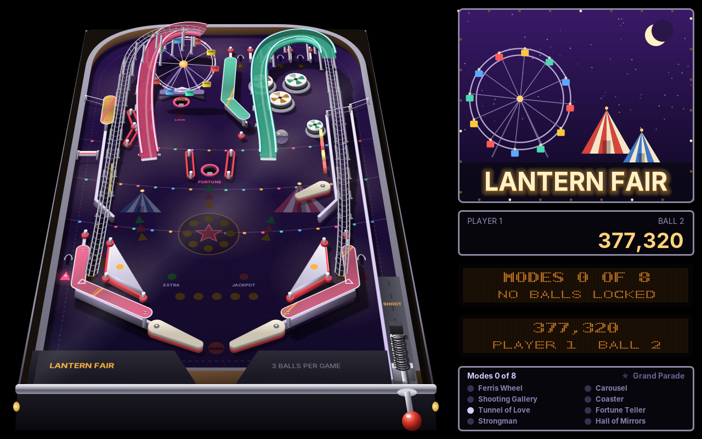

# amade-pinball-game

**amade-pinball-game** is the pinball machine of the [amadeOS](https://github.com/amadeos-eu/amadeos) desktop: three original tables, each seen from the player's end in perspective, with ramps and wire returns, pop bumpers, slingshots, drop targets, spinners, toys, a ball lock and multiball, eight modes and a wizard mode. The chrome ball rolls, bounces and spins by real physics; a dot-matrix display tells what is running. One to four players take turns. Built on [amade-game-engine](https://github.com/amadeos-eu/amade-game-engine); runs on other operating systems as well.




## The tables

- **Lantern Fair** (easy): a fairground at night. Coaster and Dipper ramps, a turning Ferris wheel that locks the balls, the carousel pop bumpers under the F·A·I·R lanes, the Fortune Teller start hole, a shooting gallery of drop targets, the Strongman standups and an upper flipper. Wizard mode: Grand Parade, four balls.
- **Coral Deep** (medium): a wreck on a reef. The Sub Tube carries the ball up into the Wreck Hold, a mini playfield with its own pair of flippers; the Kraken swallows balls for the lock; a pearl sits on a captive ball; the whirlpool magnet grabs the ball and flings it. Wizard mode: Abyss.
- **Orbit Yard** (hard): a dockyard in orbit. Launch and Re-entry ramps cross over the middle, a lift carries the ball to the Moon Dock upper playfield with its visible lock tube, the satellite spin disc throws the ball, five hangar drop targets guard the start hole, and a kickback saves the left outlane. Wizard mode: Launch Window, five balls.

## Playing

- On the title the robot plays the chosen table. **Left** and **right** choose the table, **up** and **down** or **1** to **4** the number of players, **Enter** starts. The title remembers both.
- **Left Shift** and **right Shift** (or **Z** and **-**) work the flippers of their side; the upper flippers move with the lower ones.
- Hold **Space** or **down** to pull the plunger and let go to shoot: the longer, the harder. The right strength is the skill shot: into the lit top lane on Lantern Fair (the flipper buttons move the lit lane), onto a treasure standup on Coral Deep, into the satellite on Orbit Yard.
- **X**, **.** and **up** nudge the table to the left, to the right and forwards. After three warnings the ball tilts.
- **Esc** or **P** pauses, and so does leaving the window; **Q** in the pause ends the game. *Game → Choose table* goes back to the title.
- The rules: the start hole starts the mode its lamp shows; each mode lights its shots for a time. Ramps light the lock; three locked balls start the multiball with jackpots and a super jackpot. Shots in a row are combos, the top lanes raise the bonus multiplier, a ball lost soon after the launch comes back. All eight modes played light the wizard mode.
- Gamepads: **LB** and **RB** (or **X** and **B**) are the flippers, **A** the plunger, the stick pushed hard nudges, **Start** pauses.
- **F11** switches to full screen and back. *Game → Graphics* chooses how the table reaches the screen: **Direct** or **Pixels** (640 × 400, enlarged by whole factors). **F12** shows how long each frame takes.
- Sound effects, the voice and the music can be switched off under *Game → Sound*.
- Each table has its own high score list.

The keys can be changed in `~/.config/amadeos/pinball/pinball.properties`, with the names Java gives them, several separated by spaces; `LEFT_SHIFT`, `RIGHT_SHIFT`, `LEFT_CONTROL` and `RIGHT_CONTROL` name one side's key:

```properties
keys.left-flipper=LEFT_SHIFT Z
keys.right-flipper=RIGHT_SHIFT MINUS SLASH
keys.plunger=SPACE DOWN
keys.nudge-left=X
keys.nudge-right=PERIOD
keys.nudge-up=UP
keys.pause=ESCAPE P
```

Texts in English, Deutsch, Français, Español and Italiano.

## Gamepads

Plugged in before or while the game runs; any of them plays. *Help → About* shows how many are connected.

- **Linux**: the game reads `/dev/input/js0` to `js3`, which needs read access to them (on most desktops the user at the screen has it). The buttons follow the Xbox layout of the `xpad` driver.
- **Windows**: XInput, so Xbox and compatible controllers.
- Elsewhere the game runs without gamepads.

## Files

| What | Where |
|---|---|
| Settings (graphics, sound, keys, the last table, players) | `~/.config/amadeos/pinball/pinball.properties` |
| High scores, one list per table | `~/.local/share/amadeos/games/pinball/` |

## Building

```bash
./gradlew test          # the window test needs a display (xvfb-run on servers)
./gradlew run
./gradlew deb           # build/distributions/amade-pinball-game_<version>_all.deb
./gradlew installToAmadeOs   # copies the package to ../amadeos/config/packages.chroot/
./gradlew benchmark     # how long baking each table and drawing its frames takes
```

Gamepads on Windows go through Java's foreign function interface, so the game starts with `--enable-native-access=ALL-UNNAMED` (set in `build.gradle` for `run`, the tests and the packages).

All pictures are drawn with Java2D shapes at run time; the icon is drawn by `tools/MakeIcon.java`. `./gradlew screenshots -Pshots=<folder>` draws the handbook's screenshots.

With `../amade-game-engine` (and `../amade-commons`) checked out next to this repository, Gradle builds those checkouts instead of the JitPack versions.

## The table files

Each table is a text file in `src/main/resources/eu/amadeos/games/pinball/tables/`, read after `common.table` (the cabinet, the lower flippers, slingshots and lanes that all tables share). One part per line: its kind, an id, then numbers in table units (232 wide, 392 long, y down towards the player) and options as `key=value`; `@1` puts a part on the raised layer. For example:

```
bumper pop1 146 82 10 p3 xfff4e0
ramp dipper p7 12 path 148 176 C 150 130 130 60 160 40 C 184 26 204 40 204 70 wire C 206 140 206 220 193 300
saucer fortune 104 190 p6 out=95 kick=340
mode Coaster shots=coaster count=3 time=40 value=60000
```

The same file draws the table and builds its physics, so a new table needs no code.

## Structure

- `domain`: the machine and its rules, without user interface or time of their own. `TableFile` and `TableSpec` (the table files), `Part`, `Path` (paths of walls and ramps), `Table` (builds the playfield from the parts: walls, flippers, bumpers, slingshots, targets, holes, spinners, ramps, tracks, magnets, layers; the plunger, ball serve and kick-outs), `Game` (players, balls, ball save, tilt, bonus, ball search), `Rules` (scoring, modes and stacking, lock and multiball, jackpots, combos, skill shot, extra ball, wizard mode, the lamps), `Progress` (one player's state), `Robot` (plays the attract mode and the tests), `Input`, `Message`, `Sfx`.
- `repository`: `PinballSettings` (graphics, sound, keys, last table and players).
- `ui.game`: the running game on the loop thread. `PinballGame` (loop, controls, scenes: title with the robot, play, pause, game over), `TableArt` (bakes the table picture and its raised parts once), `TableView` (tilts it into perspective on a background thread and draws the moving parts, lamps and balls on it), `Art` (the drawings of the parts), `Backglass` (art, scores, the two dot-matrix windows, the modes), `Displays` (what the dot-matrix windows show), `Cards`, `SoundBank`, `Music` (the tunes, in MML), `Arena` (what the presenter may ask of the game).
- `ui.main`: Model-View-Presenter for everything around the table: `PinballPresenter`, `PinballView`, `PinballWindow`.

From the engine's `pinball` package: `Playfield` (ball physics with sub-steps, segments and arcs, materials, layers and tracks), `Flipper`, `Plunger`, `Ball`, `Track`, `Zone`, `Disc`, `Tilt`, `Lamps`, `DotMatrix`, `Perspective`, `Relief`, `RampArt`, `ChromeBall`. Also `HighScores`, `Gamepads`, `GameLoop`, `GameCanvas`, `Sound`, `Tune`, `Speech` and `Mixer`, `Keyboard` and `Controls`, `SceneStack`, `FullScreen`.

Comments of the form `// --8<-- [start:name]` mark the excerpts the [Game Developer's Handbook](https://docs.amadeos.eu/amade-game-engine/) quotes; chapter 70 is about this game.

## Licence

[EUPL-1.2](LICENSE)
